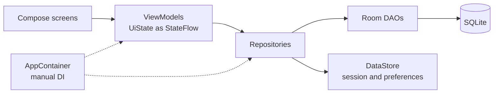

# ZOZH Mobile

An Android app for a healthy lifestyle: log meals and calories, track sleep with its phases, and
watch daily activity, all offline on the device. Built with Kotlin and Jetpack Compose on a clean
MVVM architecture.

**Stack:** Kotlin 2.0 · Jetpack Compose (Material 3) · Navigation Compose · Room · DataStore · Coroutines and Flow · kotlinx.serialization · Gradle (Kotlin DSL, version catalog)

## Features

| Area | What the user can do |
|---|---|
| Nutrition | Log meals with protein, fat and carbs, browse records by day, edit and delete |
| Sleep | Record sleep sessions with phases, see history and a detailed view of each night |
| Activity | Dashboard with steps, calories, recent workouts, heart rate and blood pressure (demo data) |
| Account | Register, log in, stay logged in after restart, splash screen while the session loads |
| Profile and settings | Profile setup after registration (age, height, weight), settings screen, input validation |

## Architecture

- **MVVM with one-way data flow.** Screens render a `UiState` from the ViewModel and send events
  back. ViewModels never touch the database directly.
- **Repository layer.** Each domain (meals, sleep, user) has a repository interface with an offline
  Room implementation and a fake data source for previews and demos.
- **Manual dependency injection.** `AppContainer` builds repositories once per application, and
  `AppViewModelProvider` creates ViewModels with their dependencies, without a DI framework.
- **Single date-time layer.** Dates and times go through shared converters and pickers, so every
  screen stores and displays them the same way.
- **Room with relations.** Sleep sessions and their phases are stored as a one-to-many relation
  (`SleepWithPhases`), and a type converter stores `ZonedDateTime` as epoch seconds.

## Branches

| Branch | State |
|---|---|
| `master` | App architecture, nutrition and sleep tracking (merged through PR #2) |
| `dev` | Full build: everything in `master` plus login and registration, profile setup, settings and the activity dashboard |
| `login`, `physical-activity`, `sleep-data` | Feature branches, already integrated into `dev` |

To try the full app, build the `dev` branch.

## Team

A team project of four developers. I designed the app architecture and built the nutrition
module, the date-time layer and the user subsystem with the login screen, and reviewed and
reworked the sleep module before merging it.

---
Built as coursework for the Mobile Development course at ITMO University, 2025.
